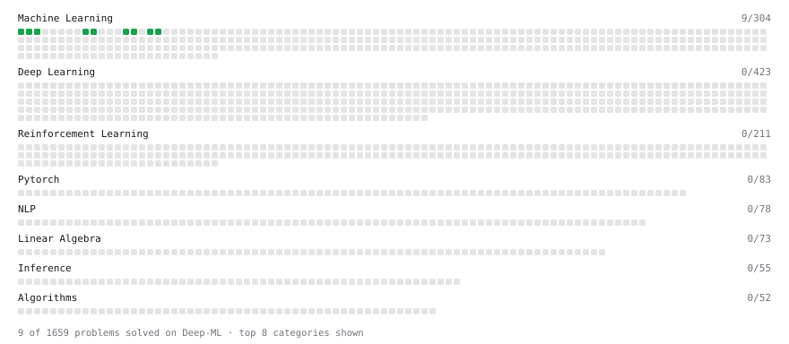

# Deep-ML

My machine learning practice from [Deep-ML](https://www.deep-ml.com). Every solution here was written by hand.

**9** solved · 9 problems · 0 labs · 0 math

[**Browse the interactive portfolio**](https://shankyty.github.io/deep-ml/) to replay this filling in over time.

## Problems

| | Difficulty | Solved | |
| --- | --- | --- | --- |
| [Batch Iterator for Dataset](https://www.deep-ml.com/problems/30) | easy | 2026-10-19 | [solution](problems/0030-batch-iterator-for-dataset) |
| [Calculate Accuracy Score](https://www.deep-ml.com/problems/36) | easy | 2026-10-25 | [solution](problems/0036-calculate-accuracy-score) |
| [Feature Scaling Implementation](https://www.deep-ml.com/problems/16) | easy | 2026-09-24 | [solution](problems/0016-feature-scaling-implementation) |
| [Implement Ridge Regression Loss Function](https://www.deep-ml.com/problems/43) | easy | 2026-10-26 | [solution](problems/0043-implement-ridge-regression-loss-function) |
| [Linear Kernel Function](https://www.deep-ml.com/problems/45) | easy | 2026-10-26 | [solution](problems/0045-linear-kernel-function) |
| [Linear Regression Using Gradient Descent](https://www.deep-ml.com/problems/15) | easy | 2026-09-23 | [solution](problems/0015-linear-regression-using-gradient-descent) |
| [Linear Regression Using Normal Equation](https://www.deep-ml.com/problems/14) | easy | 2026-09-03 | [solution](problems/0014-linear-regression-using-normal-equation) |
| [One-Hot Encoding of Nominal Values](https://www.deep-ml.com/problems/34) | easy | 2026-10-24 | [solution](problems/0034-one-hot-encoding-of-nominal-values) |
| [Random Shuffle of Dataset](https://www.deep-ml.com/problems/29) | easy | 2026-10-02 | [solution](problems/0029-random-shuffle-of-dataset) |

---

_This file is regenerated by Deep-ML on every push._
